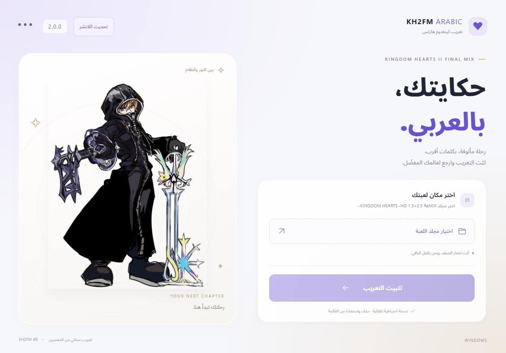

<div dir="rtl">

<div align="center">

<h1>تعريب كينغدم هارتس ٢ فاينل ميكس</h1>

<p>النصوص والواجهات بالعربية لنسخة ستيم ضمن مجموعة ١٫٥ + ٢٫٥ ريمكس.</p>

<p><strong>الإصدار 2.0.1</strong> · مجاني · ويندوز ولينكس</p>

<p>
<a href="https://github.com/exelight7/KH2FM_AR/releases/latest"><strong>⬇ تحميل التعريب</strong></a>
&nbsp; · &nbsp;
<a href="docs/releases/2.0.1.md">تفاصيل التحديث</a>
&nbsp; · &nbsp;
<a href="https://x.com/psycho_njjm">حساب المشروع على إكس</a>
</p>



</div>

---

## ✨ الجديد في 2.0.1

- **الشريط الأخضر:** إصلاح الحجم الناقص عند رسم أوامر التفاعل، بما يشمل «التقطه» و«تقديم طلب عمل».
- **التحسينات السابقة:** الحفاظ على ضبط الشريط وتحسين وضوح أسماء الأبواب والمناطق.
- **التحديث من النسخ السابقة:** ترقية التعريب مع الاحتفاظ بإمكانية الحذف والتراجع.

[اقرأ ملاحظات الإصدار كاملة ←](docs/releases/2.0.1.md)

## 📥 التحميل والتثبيت

| نظامك | الملف المناسب |
| --- | --- |
| ويندوز، معمارية ٦٤ بت | [تحميل المثبّت](https://github.com/exelight7/KH2FM_AR/releases/download/v2.0.1/01-KH2FM-Arabic-2.0.1-Windows-x64.exe) |
| لينكس وستيم ديك، معمارية ٦٤ بت | [تحميل التطبيق](https://github.com/exelight7/KH2FM_AR/releases/download/v2.0.1/02-KH2FM-Arabic-2.0.1-Linux-x64.AppImage) |

1. أغلق اللعبة، ثم افتح برنامج التعريب.
2. اختر مجلد اللعبة، واضغط **تثبيت التعريب**.
3. اختر **اللغة الإنجليزية** للعبة من إعدادات ستيم، ثم شغّلها كالمعتاد.

ملفات التعريب مرفقة بالبرنامج؛ لا تحتاج إلى تنزيل المستودع أو اتصال بالإنترنت أثناء التثبيت.

[دليل الاستخدام ولينكس والنسخ الاحتياطية ←](apps/manager/README_AR.md)

## 📦 الإصدارات المتاحة

**الإصدار العادي:** اللانشر الموصى به لمعظم المستخدمين، مع التحديث من داخله.

**[النسخة اليدوية 2.0.1](https://github.com/exelight7/KH2FM_AR/releases/tag/manual-v2.0.1):** نفس التعريب والإصلاحات داخل ملف مضغوط، دون لانشر، مع سكربتات للتثبيت والحذف. لويندوز ونسخة ستيم المختبرة. تُجهّز الملفات محليًا من نسخة المستخدم؛ لا تُرفق أرشيفات اللعبة الأصلية.

## 🔄 عندك إصدار أقدم؟

**اللانشر 1.0.11 أو أحدث:** أغلق اللعبة، ثم اختر **تحديث اللانشر ← تنزيل الإصدار 2.0.1 ← التحديث وإعادة التشغيل**. يتابع البرنامج تحديث التعريب في مجلد اللعبة المحفوظ.

**الإصدارات الأقدم:** نزّل المثبّت الجديد مرة واحدة واختر مجلد لعبتك الحالي؛ لا تحتاج إلى حذف التعريب أولًا.

على لينكس، استخدم ملف التطبيق بصيغة `AppImage` للتحديث من داخل البرنامج.

## 🛠️ الحذف والتراجع

من قائمة **•••** داخل البرنامج يمكنك اختيار **حذف التعريب** أو **التراجع عن آخر عملية**. احتفظ بمجلد `.kh2fm-arabic` داخل مجلد اللعبة لأنه يحتوي سجل العمليات والنسخ الاحتياطية.

تبقى ملفات الحفظ وملفات اللعبة الأصلية كما هي.

<details>
<summary><strong>🤝 للمساهمين: مراجعة النصوص العربية</strong></summary>

<br>

النصوص الحالية موجودة في مجلد [المراجعة](review/). تُرسل التصحيحات في ملفات مستقلة، دون تعديل نصوص المراجعة مباشرة.

1. اختر مهمة غير منجزة من [قائمة المهام](docs/TASKS.md).
2. اتبع [قواعد التصحيح](RULES.md) و[المسرد المعتمد](docs/glossary.md)، مع الحفاظ على الوسوم وفواصل الأسطر وحدود طول النص.
3. أضف تصحيحاتك داخل `corrections/<FILE>.csv` وفق الأعمدة المحددة في القواعد.
4. شغّل أمر الفحص وأصلح الأخطاء حتى ينجح:

```sh
python tools/validate_corrections.py
```

5. افتح طلب دمج؛ تُفحص التصحيحات تلقائيًا قبل دمجها.

| ما تحتاجه | مكانه |
| --- | --- |
| النصوص الحالية للقراءة والمراجعة | [مجلد المراجعة](review/) |
| ملفات التصحيحات | [مجلد التصحيحات](corrections/) |
| الأسماء والمصطلحات المعتمدة | [المسرد](docs/glossary.md) |
| النصوص التي تحتاج تدقيقًا إضافيًا | [قائمة المراجعة](docs/review_list.md) |
| النصوص الطويلة على الشاشة | [قائمة النصوص الطويلة](docs/long_rows.md) |
| تعليمات جلسة مراجعة سحابية | [نص الجلسة الجاهز](docs/CLOUD_PROMPT.md) |

</details>

---

<p align="center">مشروع مجاني من المعجبين، غير رسمي وغير تابع لسكوير إنكس أو ديزني.</p>

</div>
